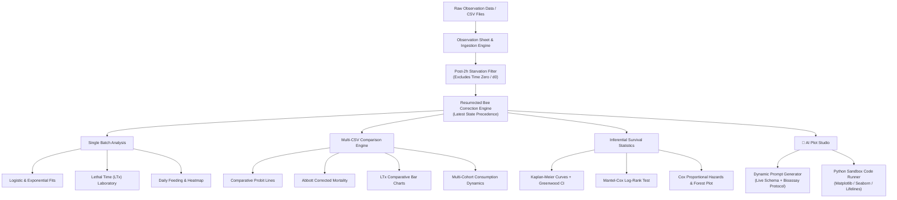

# 🐝 Bee Analytics Studio

[](https://www.python.org/)
[](https://streamlit.io/)
[](https://lifelines.readthedocs.io/)
[](LICENSE)
[](#-rigorous-bioassay-protocol--mathematical-foundations)

A publication-grade computational biostatistical suite and scientific dashboard designed for honeybee (*Apis mellifera*) toxicology, longevity kinetics, oral exposure bioassays, and nutritional feeding persistence.

---

## 📌 Table of Contents
- [Overview](#-overview)
- [Key Capabilities](#-key-capabilities)
- [System Architecture](#-system-architecture)
- [Rigorous Bioassay Protocol & Mathematical Foundations](#-rigorous-bioassay-protocol--mathematical-foundations)
- [Core Code Snippets](#-core-code-snippets)
- [Directory Structure](#-directory-structure)
- [AI Plot Studio & ChatGPT Code Runner](#-ai-plot-studio--chatgpt-code-runner)
- [Quick Start Guide](#-quick-start-guide)
- [Citation](#-citation)

---

## 🔬 Overview

Oral exposure bioassays in honeybees (*Apis mellifera*) are vital for evaluating pesticide safety, solvent toxicity, and pollinator decline. However, biological researchers frequently encounter recurring hurdles:
1. **Blinded Experimental Stages**: During the first days of testing, researchers run assays blindly using tube IDs or raw file names before the chemical solutions are unblinded.
2. **Pre-Exposure Starvation Artifacts**: Bees undergo a mandatory 2-hour pre-treatment starvation period. Pre-starvation baseline data ($t=0$, Day 0) must be strictly isolated from post-starvation lethal time modeling.
3. **Observation Inconsistencies**: Bees erroneously recorded as dead ($D$) on early days may subsequently exhibit antennae or physical mobility ($A$ or $B$).
4. **Custom Figure Creation**: Academic researchers and professors often need specialized figures for scientific publication but may not write Python code, relying on LLMs (such as ChatGPT or Claude) for scripting.

**Bee Analytics Studio** solves these challenges with an integrated, mathematically rigorous, reproducible framework.

---

## ✨ Key Capabilities

- **Blinded & Unblinded Legend Management**: Effortlessly switch plot legends between raw file names (blinded mode), standardized protocol cohort names, publication code names (`5% Acetone 2 µL`), hybrid formats, or custom overrides.
- **Finney Probit Regression & Lethal Time ($LT_x$) Engine**: Computes $LT_{10}, LT_{20}, LT_{25}, LT_{30}, LT_{50}, LT_{75}, LT_{90}$ and custom mortality percentiles with log-time transformations and Abbott natural mortality correction.
- **Inferential Survival Statistics**: Full non-parametric **Kaplan–Meier** product-limit estimator with Greenwood standard errors, two-sided **Mantel–Cox Log-Rank** hypothesis tests, and semi-parametric **Cox Proportional Hazards Regression** with Forest plots.
- **Feeding Kinetics & Nutritional Anorexia ($FT_{50}$)**: Individual bee daily sucrose intake ($\mu\text{L}$), cumulative consumption curves, and Kaplan-Meier time-to-feeding-cessation modeling.
- **🤖 AI Plot Studio (ChatGPT Code Runner)**: Automatically packages active dataset schemas and biostatistical constraints into prompt templates for ChatGPT, and runs the generated Python code inside an interactive sandbox.
- **Interactive Observation Sheet**: Formatted digital replica of standard lab sheets with printable HTML/CSS export.
- **Publication Exports & Global Download Center**: Persistent header and sidebar download buttons for one-click downloading of all Single-CSV plots, all Multi-CSV comparison plots, or the complete master ZIP package in publication-grade 300 DPI PNG, SVG, or CSV formats.

---

## 🏛️ System Architecture



---

## 📐 Rigorous Bioassay Protocol & Mathematical Foundations

### 1. Post-2h Starvation Rule (Exclusion of Time Zero / d0)
Bees undergo a mandatory 2-hour starvation period prior to feeding exposure. Data recorded at time zero ($t=0$, `d0`, `Day 0`) constitutes pre-starvation baseline setup and is **strictly excluded** from all kinetic fits, lethal time models, Kaplan-Meier estimators, Log-Rank tests, and Cox regressions. The first observation evaluation day is Day 1 ($t = 1.0$).

### 2. Standard 4 Experimental Cohorts & Normalized Code Names
To eliminate ambiguous labels, all assays map to 4 benchmark groups:
1. `sucrose solution 2 microliter` (Code Name: `Sucrose 2 µL` | Control Baseline $HR = 1.0$)
2. `5 % acetone 2 microliter` (Code Name: `5% Acetone 2 µL`)
3. `10 % acetone 2 microliter` (Code Name: `10% Acetone 2 µL`)
4. `5 % acetone 5 microliter` (Code Name: `5% Acetone 5 µL`)
*(Files without identified treatments can remain in **Blinded Experiment Mode** as `None / Blinded`).*

### 3. Resurrected Bee Observation Correction Rule
If a bee is observed as Dead (`D`) on Day $k$ but subsequently observed as Alive (`A` or `B`) on Day $j > k$, the later alive status takes precedence. A bee is only classified as deceased at time $d^*$ if all subsequent observations through experiment conclusion remain Dead (`D`).

### 4. Abbott's Formula for Natural Mortality Correction
$$P_{\text{corrected}} = \frac{P_{\text{treatment}} - C}{1 - C}$$
Where $P_{\text{treatment}}$ is observed mortality fraction and $C$ is control mortality.

### 5. Finney Probit Linear Regression
$$\text{Probit}(P) = a + b \log_{10}(t)$$
Where $P$ is cumulative mortality probability converted via normal quantiles: $\text{Probit}(P) = \Phi^{-1}(P) + 5.0$.

### 6. Non-Parametric Kaplan-Meier Estimator
$$\hat{S}(t) = \prod_{t_i \le t} \left(1 - \frac{d_i}{n_i}\right)$$
With Greenwood variance: $\widehat{\text{Var}}\{\hat{S}(t)\} = \hat{S}(t)^2 \sum_{t_i \le t} \frac{d_i}{n_i(n_i - d_i)}$.

---

## 💻 Core Code Snippets

### 1. Finney Probit Regression & Lethal Time ($LT_x$)
```python
import numpy as np
from scipy.stats import norm, linregress

def compute_probit_parameters(elapsed_days, mortality_pct):
    valid = (mortality_pct > 0) & (mortality_pct < 100)
    x = np.log10(elapsed_days[valid])
    p = mortality_pct[valid] / 100.0
    y = norm.ppf(p) + 5.0  # Finney Probit value
    
    slope, intercept, r_val, _, _ = linregress(x, y)
    
    # Calculate median lethal time (LT50: Probit = 5.0)
    log_lt50 = (5.0 - intercept) / slope
    lt50_days = 10.0 ** log_lt50
    return slope, intercept, r_val**2, lt50_days
```

### 2. Kaplan–Meier Step-by-Step Life Table
```python
from lifelines import KaplanMeierFitter

def fit_kaplan_meier(durations, events):
    kmf = KaplanMeierFitter()
    kmf.fit(durations, event_observed=events)
    # Greenwood 95% Confidence Interval
    ci = kmf.confidence_interval_survival_function_
    median_lt50 = kmf.median_survival_time_
    return kmf, ci, median_lt50
```

---

## 📁 Directory Structure

```text
├── streamlit_app.py           # Application entry point & tab coordinator
├── requirements.txt           # Production dependencies
├── run.sh                     # Automated execution shell script
├── RUN.md                     # Clear public installation & operational guide
├── AGENTS.md                  # Protocol rules & bioassay constraints
├── modules/
│   ├── core/                  # Core mathematical & biostatistical engines
│   │   ├── batch_parser.py    # Probit regression & Abbott calculations
│   │   ├── bee_extractor.py   # Resurrected bee logic & subject duration extractor
│   │   ├── cohort_manager.py  # 4 cohorts, code names & blind mode mapping
│   │   ├── probit_engine.py   # Analytical LTx percentile interpolation
│   │   └── time_parser.py     # Post-2h starvation parser (t0 exclusion)
│   ├── single_batch/          # Single CSV Analysis modules
│   │   ├── sheet_editor.py    # Observation sheet editor & HTML print exporter
│   │   ├── survival_curves.py # Logistic, exponential, and KM curves
│   │   ├── lethal_time_view.py# LTx percentile spectrum
│   │   ├── feeding_view.py    # Sucrose consumption analytics
│   │   ├── environment_view.py# Temperature & humidity correlations
│   │   └── biostats_view.py   # Probit & residual diagnostics
│   ├── survival/              # Dedicated inferential survival laboratory
│   │   ├── kaplan_meier.py    # KM curves, Greenwood CI, & life tables
│   │   ├── log_rank.py        # Mantel-Cox test & Observed vs Expected
│   │   ├── cox_regression.py  # Cox Proportional Hazards model
│   │   └── forest_plot.py     # Hazard ratio forest plot
│   ├── tab_multi.py           # Multi-CSV Probit comparison & legend selector
│   ├── tab_survival.py        # Dedicated survival statistics tab
│   ├── tab_ai_plots.py        # 🤖 AI Plot Studio & ChatGPT Code Runner
│   ├── tab_spss.py            # SPSS data export suite
│   ├── multi_batch_consumption.py # Multi-cohort feeding kinetics
│   └── styles.py              # Custom CSS design system
```

---

## 🤖 AI Plot Studio & ChatGPT Code Runner

Designed for researchers and professors who want to generate custom figures without writing code manually:
1. **Dynamic Prompt Generator**: Automatically packages the live data schema (`survival_df`, `df`, `summary_df`, `batches`) and protocol rules (such as post-2h starvation) into an optimized prompt for ChatGPT.
2. **Interactive Code Playground**: Paste the Python snippet returned by ChatGPT or select from pre-loaded templates.
3. **Instant Rendering & High-Res Export**: Displays the plot live in the browser and exports publication-ready 300 DPI PNG or SVG figures with one click.

---

## 🚀 Quick Start Guide

For full installation and operating instructions, refer to [RUN.md](RUN.md).

```bash
# 1. Clone the repository
git clone https://github.com/your-username/bee-analytics-studio.git
cd bee-analytics-studio

# 2. Execute via setup script (macOS/Linux)
./run.sh
```

---
